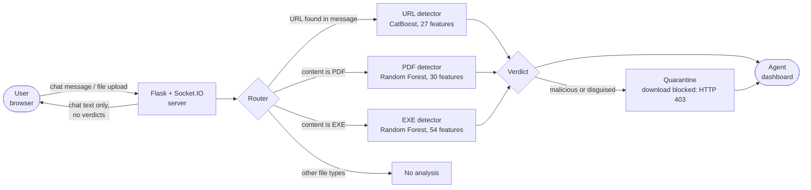
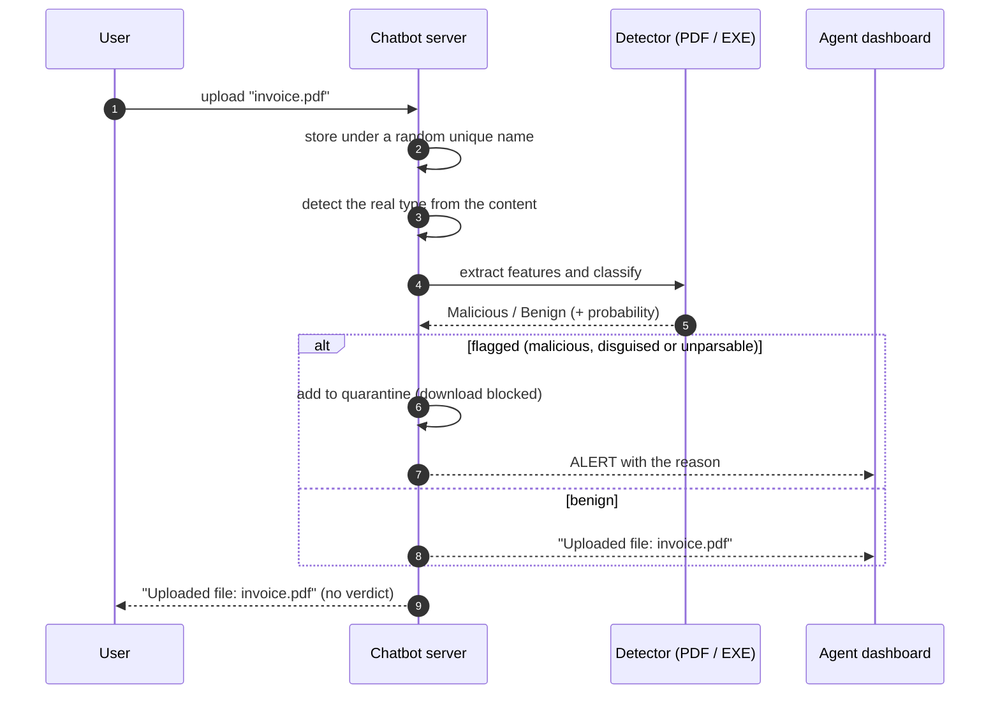
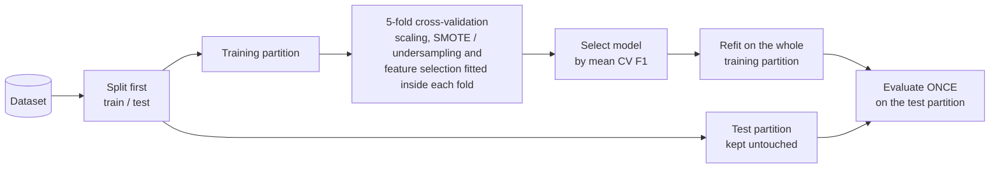

# AI-Powered Chatbot for Real-Time Detection of Malicious URLs, PDF Files and Executables

A customer-support chatbot that **checks every link and file a user sends, while the conversation is going on**, and warns the human support agent before they open anything dangerous.

* **URLs** in chat messages are classified as phishing or legitimate (CatBoost).
* **PDF files** are classified as malicious or benign (Random Forest).
* **Executables (EXE)** are classified as malicious or benign (Random Forest).
* **Disguised files** (for example, a program renamed `photo.jpeg`) are detected from their **content**, not their extension.
* Verdicts are shown **only to the agent**. Flagged files are **quarantined**: they cannot be downloaded.

This repository contains the code used in the paper *"AI-Powered Chatbot for Real-Time Detection of Malicious URLs, PDF Files, and Executables in Live Chat Environments"*.

<p align="center">
  
  &nbsp;&nbsp;
  
</p>
<p align="center"><em>The same conversation from the user's side (left) and the agent's side (right).</em></p>

---

## Contents

1. [How it works](#how-it-works)
2. [Detection pipelines](#detection-pipelines)
3. [Results](#results)
4. [Installation](#installation)
5. [Running the chatbot](#running-the-chatbot)
6. [Configuration](#configuration)
7. [Evaluation tools](#evaluation-tools)
8. [Reproducing the training](#reproducing-the-training)
9. [Project structure](#project-structure)
10. [Security notes](#security-notes)
11. [Limitations](#limitations)
12. [Acknowledgements](#acknowledgements)

---

## How it works



The file type is decided by reading the file's **content** (libmagic, with a fallback that checks the `%PDF` and `MZ` signatures). If the declared extension and the real type differ, the file is flagged as **disguised**, even if the detector itself finds nothing.

### What happens when a user uploads a file



Chat URLs follow the same path: each URL is analysed once, in the background, and an alert with the probability is sent to the agent room.

---

## Detection pipelines

| | URL detector | PDF detector | EXE detector |
|---|---|---|---|
| **Model** | CatBoost | Random Forest | Random Forest |
| **Training data** | Phishing Websites dataset (11,054 URLs) | Evasive-PDFMal2022 | PE-header malware dataset (138,047 files) |
| **Features at runtime** | 27 URL, page and domain features (`Models/URL/feature.py`) | 30 structural features read from the file (`Models/pdf/pdf_features.py`) | 54 PE-header features (`Models/Malware/pe_features.py`) |
| **Model file** | `Models/URL/pickle/catboost_model_v2.pkl` | `Models/pdf/pdf_rf_pipeline.joblib` | `Models/Malware/exe_rf_pipeline.joblib` |

### Training protocol (all three detectors)



No preprocessing step ever sees the test data, and the test partition is not used to choose the model.

### The runtime features match the training features

Each extractor computes the features **exactly as they were defined in its dataset**, so the model sees at runtime what it saw in training:

* **PDF:** general features through PyMuPDF (size in KB, pages, metadata, images, text…) and pdfid-style keyword counts (`/JavaScript`, `/OpenAction`, `/EmbeddedFile`, `/AcroForm`…), with hex-encoded names decoded.
* **EXE:** a Python 3 port of the dataset author's extractor.
  * The four fields that encode the 32/64-bit format (Machine, SizeOfOptionalHeader, ImageBase, Characteristics) are **excluded**.
  * In the training data, 64-bit files are almost always legitimate, so these fields act as a shortcut, not as a sign of maliciousness.
* **URL:** three dataset features cannot be computed at runtime, so they are excluded:
  * **WebsiteTraffic**: the Alexa service closed in 2022.
  * **PageRank**: the lookup no longer returns a result.
  * **GoogleIndex**: always returns the same value.

---

## Results

### Benchmark (held-out test partitions)

| Detector | Accuracy | Precision | Recall | F1-score |
|---|---|---|---|---|
| URL (CatBoost) | 96.52% | 96.77% | 95.29% | 96.02% |
| PDF (Random Forest) | 99.24% | 99.28% | 99.35% | 99.31% |
| EXE (Random Forest) | 99.25% | 99.85% | 99.08% | 99.47% |

### Real-world tests (files and URLs not in any dataset)

| Detector | What was tested | Result |
|---|---|---|
| URL | 21 current legitimate websites, 22 malicious URLs | **0** false alarms; 22 of 22 malicious URLs detected |
| PDF | 49 benign, 23 current malicious PDFs | Precision 77.8%; recall 30.4% (7 of 23); 2 false alarms |
| EXE | 15 benign, 10 new malicious executables | Precision 100%; recall 70% (7 of 10); 0 false alarms |

> **Note:** benchmark accuracy overstates the detection of *current* threats. Most current malicious PDFs are link-based lures without JavaScript or other active content. This kind of PDF is rare in the 2016–2022 training data, which is the most likely reason for the low PDF recall. Retrain on recent samples before any operational use.

### Latency (submission until the alert reaches the agent)

| Single request | URL | PDF | EXE |
|---|---|---|---|
| Median latency | 1.87 s | 0.13 s | 0.95 s |

The median stays under 5 seconds up to about **25 concurrent file uploads** and **100 concurrent URL submissions** (single laptop, Flask development server). Larger bursts exceed the target; see the paper, Section 4.3.

---

## Installation

**Requirements:** Python **3.10**. The saved models need scikit-learn 1.0.2 and imbalanced-learn 0.9.0, and `requirements.txt` pins both.

### Windows (Command Prompt)

```bat
git clone https://github.com/Aljawhara-2012/ai-chatbot-detection.git
cd ai-chatbot-detection
py -3.10 -m venv venv
venv\Scripts\activate
pip install -r requirements.txt
```

### Linux / macOS

```bash
git clone https://github.com/Aljawhara-2012/ai-chatbot-detection.git
cd ai-chatbot-detection
python3.10 -m venv venv
source venv/bin/activate
pip install -r requirements.txt
# libmagic is needed for content-type detection:
#   Ubuntu/Debian: sudo apt install libmagic1      macOS: brew install libmagic
```

---

## Running the chatbot

```bat
venv\Scripts\activate
python app.py
```

Then open two browser windows:

| Page | Address | Who uses it |
|---|---|---|
| User chat | <http://127.0.0.1:5000> | the customer |
| Agent dashboard | <http://127.0.0.1:5000/agent> | the support agent |

### Try it

1. In the **user** window, choose a question from **Select a Question**. The chatbot answers automatically.
2. Click **Talk to Agent**. The agent window joins the conversation.
3. Send a link, or click **Upload File** and choose a PDF or EXE.
4. Watch the **agent** window. A red **ALERT** appears with the reason when something is flagged, for example:
   * `Malicious URL from <user>: http://… (100.0%)`
   * `Suspicious file Anood.jpeg: declared .jpeg but content is EXE; EXE detector (Random Forest) classified the content as malicious`
   * `Suspicious file invoice.pdf: PDF detector (Random Forest) classified the content as malicious`

<p align="center"></p>

---

## Configuration

All settings are environment variables. The defaults are safe for a local demo.

| Variable | Default | Meaning |
|---|---|---|
| `CHATBOT_HOST` | `127.0.0.1` | Address the server listens on |
| `CHATBOT_PORT` | `5000` | Port |
| `CHATBOT_UPLOAD_DIR` | `uploads` | Where uploaded files are stored (random names) |
| `CHATBOT_SECRET_KEY` | random | Flask secret key |
| `CHATBOT_URL_WORKERS` | `32` | Threads used for URL analysis |
| `CHATBOT_EVAL_MODE` | off | `1` returns verdicts in HTTP responses. **For the evaluation scripts only.** |
| `CHATBOT_PDF_LINK_CHECK` | off | `1` also checks the links inside PDFs with the URL detector. Evaluated and **not** adopted, because of too many false alarms on benign PDFs. |

Windows example:

```bat
set CHATBOT_EVAL_MODE=1
python app.py
```

To switch it off again: `set CHATBOT_EVAL_MODE=` (empty), then restart.

---

## Evaluation tools

All tools are in `tools/` and are run from the project folder with the virtual environment active.

| Script | Purpose | Example |
|---|---|---|
| `evaluate_deployed.py` | Uploads a folder of benign and malicious files through the real `/upload` endpoint. Reports confusion matrices and precision, recall and F1 per file type. **Start the server with `CHATBOT_EVAL_MODE=1` first.** | `python tools\evaluate_deployed.py --benign C:\eval\benign --malicious C:\eval\malicious --out eval_results` |
| `load_test.py` | Measures latency from submission until the alert reaches the agent (mean, median, P95, P99, % within 5 s) at increasing concurrency | `python tools\load_test.py --pdf-dir C:\load\pdf --exe-dir C:\load\exe --urls tools\urls.csv` |
| `compare_url_models.py` | Runs the previous and the current URL model on the same feature vectors | `python tools\compare_url_models.py --urls tools\urls_eval.csv --out url_compare` |
| `dump_features.py` | Saves the features the extractors compute for each file (no server needed) | `python tools\dump_features.py --benign … --malicious …` |
| `make_urls.py` | Builds `tools/urls.csv` from 20 legitimate sites and the OpenPhish feed (text only; no page is opened) | `python tools\make_urls.py` |
| `collect_features.py` | Computes features for recent samples, for retraining | see the script header |

The evaluation tools read files; they **never run or open** them.

---

## Reproducing the training

The datasets are public and are **not** included in this repository. Download them, then run:

```bat
python training\url_experiments_v2.py  path\to\phishing.csv
python training\url_train_v2.py        path\to\phishing.csv
python training\pdf_experiments.py     path\to\PDFMalware2022.csv
python training\exe_experiments_v2.py  path\to\data.csv
```

| Script | What it does |
|---|---|
| `url_experiments_v2.py` | Compares 10 URL classifiers by 5-fold CV on the training partition (27 features) |
| `url_train_v2.py` | Trains the deployed CatBoost URL model |
| `pdf_experiments.py` | Leakage-free PDF protocol (split first, CV, nested CV); saves the RF and SVM pipelines |
| `exe_experiments_v2.py` | Leakage-free EXE protocol without the 32/64-bit fields; saves the deployed RF pipeline |
| `url_experiments.py`, `exe_experiments.py` | Earlier versions (with all URL features / with the bitness fields), kept for comparison |

---

## Project structure

```
ai-chatbot-detection/
├── app.py                     # Flask + Socket.IO server: routing, quarantine, agent alerts
├── requirements.txt
├── CHANGES.md                 # What changed compared with the previous version
├── Models/
│   ├── URL/
│   │   ├── feature.py         # URL feature extraction (30 features; 27 used)
│   │   ├── app.py             # loads the CatBoost model (wrapper: 27 features)
│   │   └── pickle/catboost_model_v2.pkl
│   ├── pdf/
│   │   ├── pdf_features.py    # 30 PDF features
│   │   ├── detector.py        # Random Forest PDF detector
│   │   ├── links.py           # link extraction (optional link check)
│   │   ├── pdf_rf_pipeline.joblib
│   │   └── pdf_svm_pipeline.joblib   # comparison only
│   └── Malware/
│       ├── pe_features.py     # 54 PE-header features
│       ├── detector.py        # Random Forest EXE detector
│       └── exe_rf_pipeline.joblib
├── templates/                 # user_interface.html, agent_interface.html, faq.json
├── static/                    # styles and icon
├── tools/                     # evaluation and load-test scripts
├── training/                  # training and model-selection scripts
├── docs/                      # images used in this README
└── legacy_r7/                 # previous version, kept for reference only (do not deploy)
```

---

## Security notes

* ⚠️ **Never test with real malware on a normal computer.** Use a virtual machine or an isolated computer. Put the test files in a folder excluded from antivirus scanning, and **never open or run them**. The chatbot only reads files; it never executes them.
* Do **not** commit the `uploads/` folder. It can contain the files users uploaded, including malware. It is listed in `.gitignore`.
* This is a **research prototype** running on Flask's development server. Before real deployment you need at least:
  * a production WSGI server (for example Gunicorn with eventlet);
  * HTTPS;
  * authentication for the agent dashboard;
  * an egress proxy for the URL analysis (SSRF protection);
  * upload size limits per user.
* Chat text and file names are HTML-escaped, and verdicts are never sent to the user, so an attacker cannot see which files were detected.

---

## Limitations

* **Static analysis only:** packed, encrypted or zero-day samples can be missed, because nothing is executed in a sandbox.
* **Concept drift:** the training datasets date from before 2023. Recall on current PDFs is low (30.4%), and periodic retraining on recent samples is needed.
* **Small real-world test sets:** for example, 10 new malicious executables. Treat those percentages as indicative.
* **Single host:** the 5-second target is met for normal load, but not for bursts of 150 concurrent requests on one laptop.

---

## Acknowledgements

* The EXE feature extractor is a Python 3 port of the extractor published by the PE-header dataset's author (Te-k, MIT licence).
* Datasets: Phishing Websites dataset; Evasive-PDFMal2022 (Canadian Institute for Cybersecurity); PE-header malware dataset (138,047 files).
* Phishing URLs for testing: OpenPhish community feed. Malware samples for testing: MalwareBazaar.

If you use this code, please cite the paper above.
